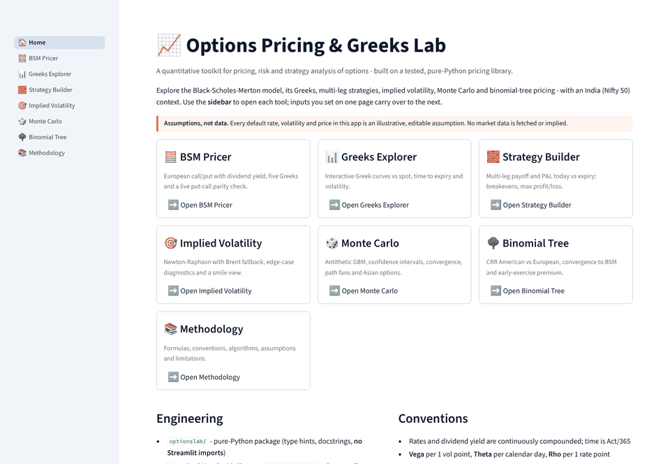
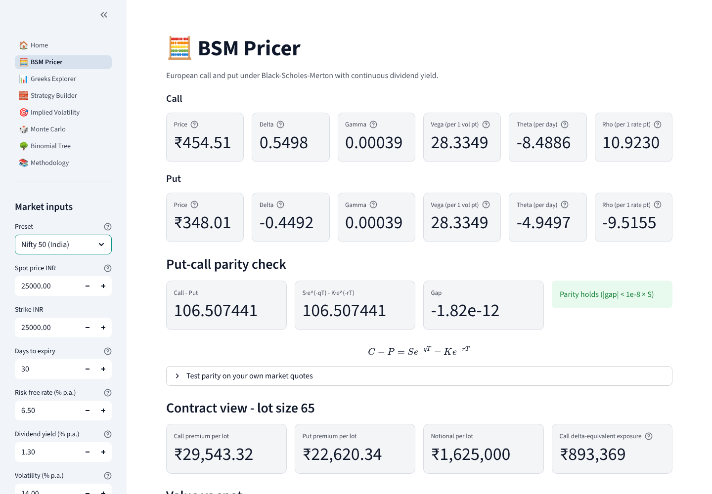
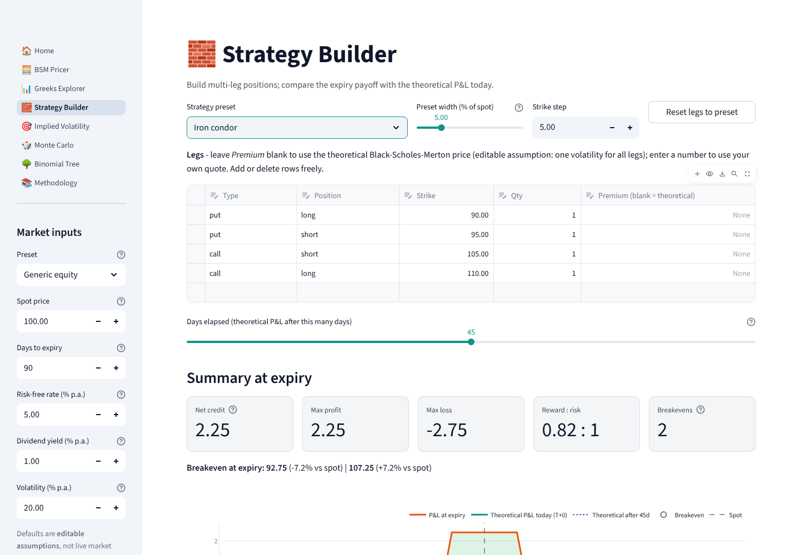
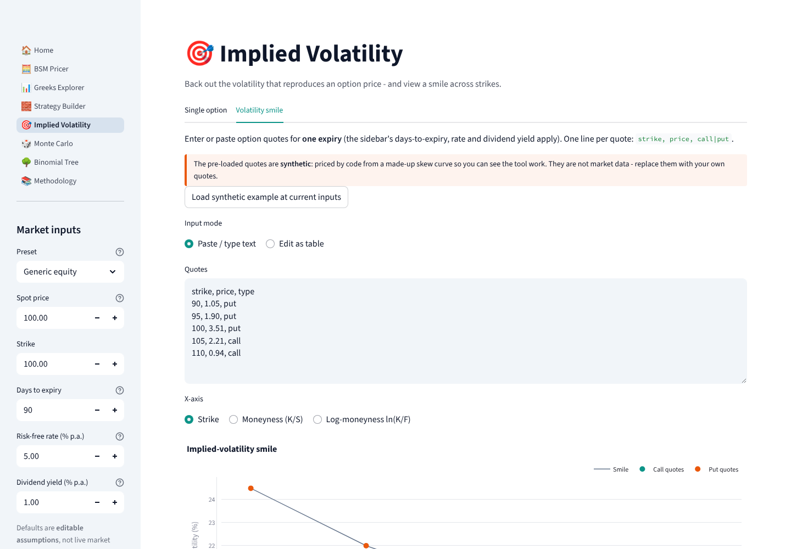
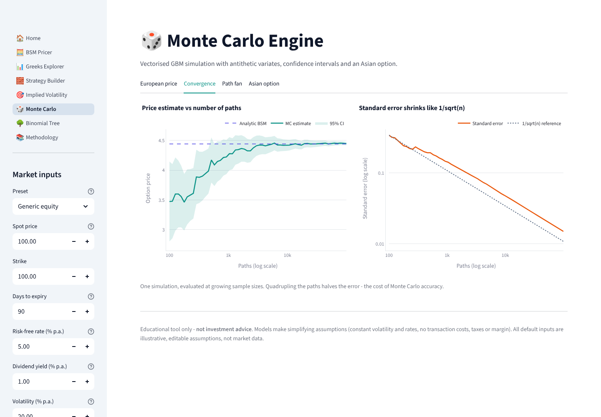

# Options Pricing & Greeks Lab

An interactive quantitative toolkit for pricing options, measuring risk and analysing multi-leg strategies, built in **Python + Streamlit** on top of a **tested, pure-Python pricing library** (`optionslab/`, no Streamlit imports).

**Live app:** `https://options-pricing-greeks-lab-bs66px3bvtzulfgs6ecmdm.streamlit.app/` *(placeholder — replace after deploying, see [Deploy](#deploy-to-streamlit-community-cloud))*



> **Disclaimer.** Educational project. Nothing here is investment advice. All default spots, rates, dividend yields and volatilities are **illustrative, editable assumptions**; no market data is fetched, stored or implied.

## Screenshots

| BSM pricer (Nifty 50 preset) | Strategy builder (iron condor) |
|---|---|
|  |  |
| **Implied-volatility smile** | **Monte Carlo convergence** |
|  |  |

More in [`docs/screenshots/`](docs/screenshots) (Greeks explorer, path fan chart, binomial tree).

## Features

| Page | What it does |
|---|---|
| **BSM Pricer** | European call/put with continuous dividend yield; price, Delta, Gamma, Vega, Theta (per day), Rho; live put-call parity check; per-lot contract view when a lot size is set. |
| **Greeks Explorer** | Each Greek plotted against spot, time to expiry and volatility, with call/put toggle and a one-line explanation of every Greek. |
| **Strategy Builder** | Editable legs (long/short call, put, stock) and presets: covered call, bull call spread, straddle, strangle, iron condor. Plots expiry payoff **and** theoretical value today / after N days; exact breakevens, max profit, max loss. |
| **Implied Volatility** | Newton-Raphson with Brent fallback; explicit messages for price below intrinsic, above the no-arbitrage cap, IV outside the solvable range and poorly-determined (low-vega) quotes. Smile view from pasted or typed strike/price pairs. |
| **Monte Carlo** | Vectorised NumPy GBM, antithetic variates, price + standard error + 95% CI, convergence chart vs analytic BSM, path fan chart, and an **arithmetic-average Asian option** (optional geometric-Asian control variate). |
| **Binomial Tree** | Cox-Ross-Rubinstein, American vs European, convergence to BSM, early-exercise premium. |
| **Methodology** | Formulas, conventions, algorithms, assumptions and limitations. |
| **India context** | Nifty 50 index-option preset with an editable lot size. Defaults are labelled assumptions. |

## Formulas (summary)

With continuous dividend yield `q`, `d1 = [ln(S/K) + (r − q + σ²/2)T] / (σ√T)`, `d2 = d1 − σ√T`:

- Call `C = S e^(−qT) N(d1) − K e^(−rT) N(d2)`; Put `P = K e^(−rT) N(−d2) − S e^(−qT) N(−d1)`
- Parity: `C − P = S e^(−qT) − K e^(−rT)`
- Delta (call) `e^(−qT) N(d1)`; Gamma `e^(−qT) φ(d1) / (S σ √T)`; Vega `S e^(−qT) φ(d1) √T`
- Monte Carlo: `S_T = S₀ exp[(r − q − σ²/2)T + σ√T Z]`, `SE = e^(−rT) s/√n`, 95% CI = estimate ± 1.96·SE
- CRR: `u = e^(σ√Δt)`, `d = 1/u`, `p = (e^((r−q)Δt) − d)/(u − d)`

Display units: Vega per 1 vol point, Theta per calendar day (÷365), Rho per 1 rate point. Full derivations and limitations are on the in-app **Methodology** page.

## Project layout

```
app.py                  # Streamlit router (st.navigation)
views/                  # one file per page
app_utils/              # shared UI helpers, theme, cached compute wrappers (@st.cache_data)
optionslab/             # pure-Python pricing library (typed, documented, Streamlit-free)
  bsm.py  implied_vol.py  monte_carlo.py  binomial.py  strategies.py  india.py  validation.py
tests/                  # pytest suite + headless page-render smoke tests
scripts/                # capture_assets.py (screenshots/GIF), keep_alive.py
.github/workflows/      # ci.yml (pytest), keep-alive.yml (scheduled ping)
.streamlit/config.toml  # theme and server settings
```

## Run locally

```bash
python -m venv .venv && source .venv/bin/activate      # Windows: .venv\Scripts\activate
pip install -r requirements.txt
streamlit run app.py
```

Developed and tested on Python 3.11.

## Tests

```bash
pip install -r requirements-dev.txt
pytest
```

The suite (155 tests) covers: BSM against textbook (Hull) values, put-call parity, every Greek against central finite differences, IV round-trips and all error paths, Monte Carlo estimates inside their own confidence interval of BSM (plus Asian and control-variate checks), CRR convergence to BSM and American ≥ European, strategy breakevens / max profit / max loss, and a headless render of every page with `streamlit.testing.v1.AppTest`.

## Deploy to Streamlit Community Cloud

1. Push this repository to GitHub (public repos work on the free tier).
2. Go to <https://share.streamlit.io> and sign in with GitHub.
3. Click **Create app → Deploy a public app from GitHub**.
4. Repository: `Poet-Philosopher/options-pricing-greeks-lab`; branch: `main`; main file path: `app.py`.
5. Open **Advanced settings** and choose **Python 3.11** (matches what the project was tested on).
6. Click **Deploy**. The first build installs `requirements.txt` and takes a few minutes.
7. Choose a custom subdomain under **Settings → General**, then paste the final URL into this README's "Live app" line and into the `APP_URL` repository variable (next section).

## Keeping the app awake (best effort, not guaranteed)

Free Streamlit Community Cloud apps are put to sleep after a period without visitors (currently about 12 hours) and show a "get this app back up" button.

`.github/workflows/keep-alive.yml` runs every 8 hours, opens the app in headless Chromium (a real visit, since a plain HTTP request does not execute the page), clicks the wake-up button if shown, and waits until the app renders.

Setup: **GitHub repo → Settings → Secrets and variables → Actions → Variables → New repository variable** `APP_URL` = your app URL. You can also trigger it manually from the **Actions** tab.

**This is not a guarantee.** Reasons it can fail:
- Streamlit may change its inactivity policy or page markup; `scripts/keep_alive.py` depends on both (it was only tested against a local Streamlit server, not the hosted site).
- GitHub scheduled workflows can be delayed or skipped under load, and GitHub disables scheduled workflows in a repository with no activity for 60 days.
- A wake-up takes time, so a visitor arriving mid-restart may still see a loading screen.

That is why the README carries a demo GIF and screenshots: the project still looks good if the app is asleep. Regenerate them with:

```bash
pip install -r requirements-dev.txt && playwright install chromium
streamlit run app.py --server.port 8599 &
python scripts/capture_assets.py --url http://localhost:8599
```

## Limitations

Constant volatility and rates; continuous dividend yield only; log-normal returns (no jumps); strategy P&L ignores costs, taxes, spreads and margin. The Nifty lot size (65) reflects the NSE figure reported from the January 2026 series — NSE revises it periodically, so verify it on nseindia.com. The field is editable.

## License

MIT — see [LICENSE](LICENSE).
